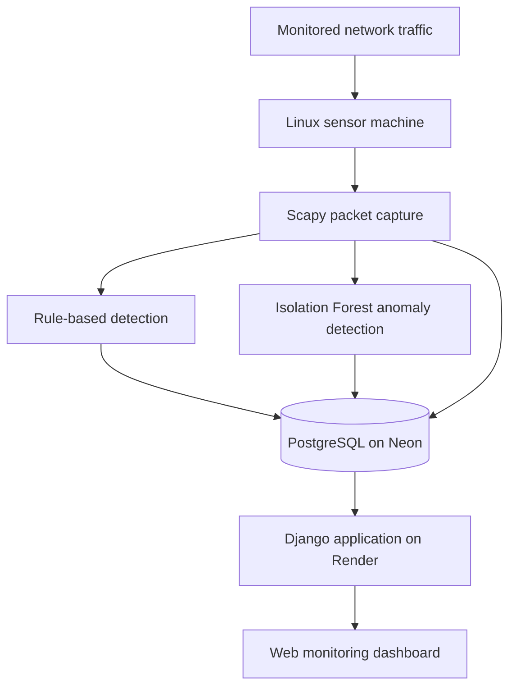
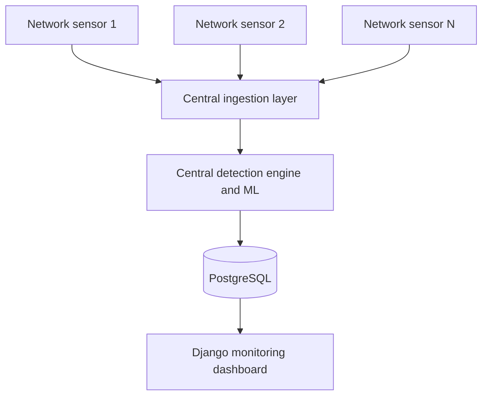

<!--
  NIDS README — documentation-only refresh.
  This update changes README.md only; application source code is not modified.
-->

<div align="center">

  

  <p><strong>A hybrid network monitoring and intrusion-detection project.</strong></p>
  <p>📡 Packet capture · 🔍 Rule-based detection · 🤖 Anomaly detection</p>

  <p>
    <a href="https://nids-django.onrender.com/"></a>
    <a href="https://github.com/dieudonne670/nids-django-"></a>
  </p>

  <p>
    
    
    
    
    
    
  </p>

  <sub>Built by <a href="https://github.com/dieudonne670">Kindong Dieudonne</a></sub>

</div>

---

## 🌌 What is NIDS?

A Network Intrusion Detection System (NIDS) observes network activity and helps identify traffic patterns that may indicate suspicious behaviour.

This project combines a **Scapy-based packet sensor**, a **Django monitoring dashboard**, rule-based detection logic and an **Isolation Forest** anomaly-detection component. Captured traffic and detection results are stored in PostgreSQL so they can be reviewed through the web interface.

The deployed dashboard is available at **[nids-django.onrender.com](https://nids-django.onrender.com/)**.

> **Project scope:** This is an educational and portfolio project for demonstrating network monitoring, backend development and introductory machine-learning techniques. It is not presented as a complete enterprise NIDS or a replacement for a production security platform.

## ✨ Features

| Capability | Description |
| --- | --- |
| 📡 Live packet capture | Uses Scapy to capture traffic from the sensor machine's network interface |
| 🔍 Rule-based detection | Detection rules for port scans, SYN floods, ICMP floods and repeated SSH attempts |
| 🤖 Anomaly detection | Uses Isolation Forest to flag traffic observations that differ from learned patterns |
| 🗄️ Persistent storage | Stores captured traffic and related information in PostgreSQL |
| 📊 Monitoring dashboard | Django interface for traffic, alerts, protocol distribution and event statistics |
| 📄 Reports | CSV export and PDF report functionality documented by the project |
| ☁️ Cloud dashboard | Django application deployed on Render, with PostgreSQL hosted on Neon |

## 🧠 Detection approach

NIDS uses two complementary approaches.

### 1. Rule-based detection

The documented detection engine looks for patterns associated with:

- **Port scanning:** repeated connection attempts across multiple ports.
- **TCP SYN floods:** unusually high volumes of TCP SYN packets.
- **ICMP floods:** unusually high volumes of ICMP traffic.
- **SSH brute-force attempts:** repeated SSH connection attempts.

These are traffic-pattern indicators. Detection thresholds and observations should be tuned and validated in the environment where the sensor is used.

### 2. Machine-learning anomaly detection

The project includes an unsupervised anomaly-detection component based on **Isolation Forest** from Scikit-learn.

At a high level:

```text
Captured traffic
      |
      v
Feature extraction
      |
      v
Isolation Forest
      |
      +------> Typical observation
      |
      +------> Anomalous observation
```

Isolation Forest identifies observations that differ from the model's learned distribution. An anomaly is **not automatically proof of an attack**; it is a signal that may need further investigation.

### Hybrid detection model

```text
Known traffic patterns                 Unusual traffic behaviour
        |                                         |
        v                                         v
Rule-based detection                      Isolation Forest
        |                                         |
        +-------------------+---------------------+
                            |
                            v
                 Security monitoring dashboard
```

## 🏗️ System architecture

The deployed design separates packet capture from the cloud-hosted dashboard. The sensor runs on a Linux machine that can access the network interface being monitored. It writes captured information to the shared PostgreSQL database, while the Django application hosted on Render reads and displays the stored data.



### Why is packet capture separate from the dashboard?

The cloud-hosted Django service does not directly capture packets from the physical network interface on the developer's local machine. The packet sensor therefore runs separately on the Linux machine with access to the monitored network. Both the sensor and hosted dashboard use the configured PostgreSQL database.

This is an important deployment detail: **the dashboard being online does not mean the Render service is sniffing the network where the user is browsing.** The sensor must be running and connected to the database for fresh captured traffic to appear.

## 🖥️ Dashboard

The Django dashboard brings captured traffic and detection information into one interface.

Documented dashboard capabilities include:

- 📈 Traffic statistics
- 🚨 Security alerts
- 🌐 Protocol distribution
- 📊 Attack and event statistics
- 🕒 Traffic timeline
- 📋 Traffic logs
- 📤 CSV export
- 📑 PDF reports
- 🔄 Automatic dashboard updates

<p align="center">
  <a href="https://nids-django.onrender.com/">
    
  </a>
</p>

## 🧰 Technology stack

| Area | Technology | Role |
| --- | --- | --- |
| Language | Python | Core application and sensor logic |
| Backend | Django | Web application and dashboard |
| Packet analysis | Scapy | Network packet capture and inspection |
| Machine learning | Scikit-learn | Isolation Forest anomaly detection |
| Database | PostgreSQL | Persistent traffic and application data |
| Database hosting | Neon | Hosted PostgreSQL database |
| Application hosting | Render | Hosted Django dashboard |
| Web server | Gunicorn | Django application server |
| Frontend | Django templates, HTML, CSS, Bootstrap | Dashboard interface |
| Charts | Chart.js | Dashboard visualizations |
| Reporting | ReportLab | PDF report generation |
| Sensor environment | Linux / Ubuntu | Network interface access and packet capture |
| Version control | Git and GitHub | Source control |

## 📁 Project structure

The following structure is based on the project layout documented in this repository.

```text
NIDS-Django-/
├── dashboard/
│   ├── templates/
│   │   └── dashboard/
│   │       ├── alerts.html
│   │       ├── index.html
│   │       ├── reports.html
│   │       └── traffic.html
│   ├── admin.py
│   ├── models.py
│   ├── urls.py
│   └── views.py
├── detection_engine/
│   ├── migrations/
│   └── detection.py
├── ml_module/
│   ├── migrations/
│   └── models.py
├── packet_capture/
│   ├── migrations/
│   └── sniffer.py
├── nids_project/
│   ├── settings.py
│   ├── urls.py
│   └── wsgi.py
├── manage.py
├── requirements.txt
├── .gitignore
└── README.md
```

## ⚙️ Run locally

### Prerequisites

- Python 3
- pip
- PostgreSQL database
- Linux environment for live packet capture
- Network interface access for the sensor

The exact Python and dependency versions should be taken from the repository's current environment and dependency files.

### 1. Clone the repository

```bash
git clone https://github.com/dieudonne670/nids-django-.git
cd nids-django-
```

### 2. Create and activate a virtual environment

```bash
python3 -m venv venv
source venv/bin/activate
```

### 3. Install dependencies

```bash
pip install -r requirements.txt
```

### 4. Configure environment variables

Create a local `.env` file in the project root and configure the settings expected by the Django project. The original project documentation identifies these variables:

```dotenv
SECRET_KEY=replace-with-a-local-secret
DEBUG=True
DATABASE_URL=your-postgresql-connection-string
```

Use your own local values. Never commit real secrets, database credentials or production environment files to Git.

### 5. Apply migrations

```bash
python manage.py migrate
```

### 6. Start the Django development server

```bash
python manage.py runserver
```

Open [http://127.0.0.1:8000/](http://127.0.0.1:8000/) in your browser.

## 📡 Run the packet sensor on Linux

The sensor must run on a machine with access to the network interface you intend to monitor.

The repository documentation gives the following command:

```bash
sudo python packet_capture/sniffer.py
```

If you need to use the project's virtual environment explicitly, the documented alternative is:

```bash
sudo ./venv/bin/python packet_capture/sniffer.py
```

Running packet capture may require elevated privileges. Use the minimum privileges needed and only capture traffic on networks you own or are explicitly authorized to monitor.

The sensor uses the configured database connection to persist captured information for the dashboard.

## 🧪 Safe testing

Test detection behaviour only in a lab or on networks for which you have explicit authorization.

The README documents test scenarios corresponding to the supported detection rules:

- Port-scan-like connection patterns
- TCP SYN traffic spikes
- ICMP traffic spikes
- Repeated SSH connection attempts

Use controlled traffic generation and document the thresholds, test conditions and observed results. Avoid testing against third-party networks or systems without permission.

## 🔐 Security and operational considerations

Network telemetry can contain sensitive information. A responsible deployment should consider:

- Keep `.env`, Django secret keys and database credentials out of version control.
- Set `DEBUG=False` in production.
- Configure allowed hosts and trusted origins explicitly.
- Use HTTPS for the hosted dashboard and encrypted database connections.
- Restrict database access to the sensor and application components that require it.
- Limit access to dashboard accounts and security reports.
- Avoid collecting or retaining payload data that is not required for the monitoring purpose.
- Protect exported CSV and PDF reports because they may contain network information.
- Monitor sensor health and database connectivity.
- Rotate any credential that has been exposed.

The current project documentation describes basic environment-variable and deployment practices. The additional controls above are recommendations for hardening a real deployment, not claims that every control is already implemented.

## ⚠️ Current deployment limitation

The documented live architecture has a separate local Linux packet sensor and a cloud-hosted Django dashboard:

```text
Monitored network
       |
       v
Local Linux machine
       |
       v
Scapy packet sensor
       |
       v
PostgreSQL / Neon
       ^
       |
Django application on Render
       |
       v
Live web dashboard
```

The Render web service cannot directly capture packets from the local machine's physical network interface. For fresh traffic data, the local sensor must be running and able to reach the configured database.

## 🛣️ Future improvements

The original project roadmap identifies several possible extensions.

### Detection coverage

- [ ] ARP spoofing detection
- [ ] UDP flood detection
- [ ] DNS attack detection
- [ ] HTTP flood detection
- [ ] DNS tunnelling detection
- [ ] Additional traffic features and behavioural profiling

### Machine learning and evaluation

- [ ] Supervised attack classification
- [ ] Evaluate Random Forest and XGBoost approaches
- [ ] Explore autoencoders and neural-network-based anomaly detection
- [ ] Evaluate using labelled datasets
- [ ] Report precision, recall and F1-score

### Distributed monitoring

A possible future design could support multiple sensors reporting to a central detection service:



Technologies identified for possible future exploration include Kafka, Redis, Celery, FastAPI, Docker, Kubernetes, Elasticsearch, Grafana and SIEM integration. These are roadmap ideas, not assertions that they are currently part of the deployed application.

## 🎓 What this project demonstrates

NIDS brings together several practical engineering areas:

- Python application development
- Django web development
- Network packet capture and TCP/IP concepts
- Rule-based security monitoring
- Unsupervised machine-learning anomaly detection
- PostgreSQL data persistence
- Linux networking and process execution
- Cloud application deployment
- Separation of a local network sensor from a hosted dashboard
- Technical documentation and security considerations

## ⚖️ Disclaimer

This project is intended for educational use, academic exploration, portfolio demonstration and authorized security monitoring.

It is not a complete enterprise-grade security product. Detection results can include false positives and false negatives. Do not use the system to monitor networks or systems without the owner's permission.

## 👨‍💻 Author

**Kindong Dieudonne** — Software Engineering graduate and Python Backend Developer.

- GitHub: [@dieudonne670](https://github.com/dieudonne670)
- Live project: [NIDS Dashboard](https://nids-django.onrender.com/)

<div align="center">

  <p><strong>Thanks for exploring this project!</strong></p>
  <p><sub>Built to explore the intersection of backend engineering, network security and machine learning.</sub></p>

</div>
